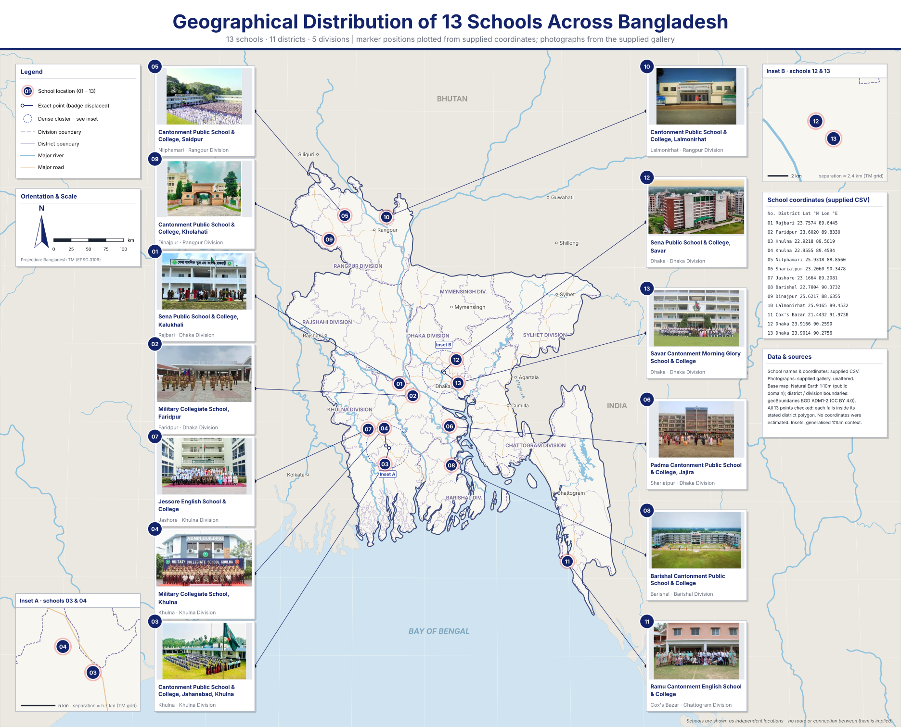
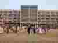
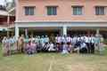
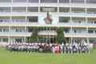

# 🏫 Feasibility Study for Infrastructure Development of Selected Military and Cantonment Educational Institutions

  
  
  
  

**Prepared by:** Md. Takbir Hossain  
&nbsp;&nbsp;&nbsp;&nbsp;&nbsp;&nbsp;&nbsp;&nbsp;&nbsp;&nbsp;&nbsp;&nbsp;&nbsp;&nbsp;&nbsp;&nbsp;&nbsp;&nbsp;&nbsp;&nbsp;&nbsp;&nbsp;*Project Engineer, Atlas Engineering Solution (AES)*  
**Reporting Date:** September 2026  
**Project Location:** Bangladesh  
**Project Sector:** Education Infrastructure Development  
**Coverage:** 13 Military and Cantonment Educational Institutions

---

## 🧭 Navigate this README

- [📌 Project overview](#project-overview)
- [🎯 Objectives](#project-objectives)
- [📍 Geographic coverage and map](#geographic-coverage)
- [📊 Project dashboard and charts](#project-dashboard)
- [🛠️ Scope and methodology](#scope-and-methodology)
- [📐 Codes and standards](#codes-standards)
- [📦 Deliverables and repository layout](#deliverables)
- [🏛️ Project significance and acknowledgement](#project-significance)

---

## 📌 1. Project Overview

This repository documents the completed feasibility study for the proposed infrastructure development of 13 selected military and cantonment educational institutions across Bangladesh.

The study was undertaken to assess existing educational infrastructure, identify institutional capacity constraints, evaluate future educational demand, and formulate institution-specific infrastructure development proposals.

The assessment considers the growing demand for quality education, the need for modern academic facilities, the rehabilitation and expansion of existing infrastructure, and the provision of safe, inclusive, climate-resilient, and sustainable educational environments.

The feasibility study provides a comprehensive technical, economic, environmental, institutional, and implementation-oriented assessment to support informed investment and development decisions.

### ✨ Project at a glance

| Project dimension | Summary |
| --- | --- |
| 📚 Education coverage | 13 military and cantonment educational institutions |
| 🗺️ Geographic spread | 11 districts across Bangladesh |
| 🏗️ Infrastructure proposal | 44 proposed structures |
| 👩‍🎓 Existing enrollment | 26,229 students |
| ➕ Proposed additional capacity | 15,550 students |
| 📐 Additional built-up area | 160,112 m² |
| 🛏️ Additional hostel capacity | 750 beds |
| 💰 Estimated capital investment | Approximately Tk. 942 crore |
| 🗓️ Implementation period stated in the report | September 2026 – August 2029 |

## 📖 2. Project Background

Military and cantonment educational institutions play an important role in providing structured and quality education to both military and civilian communities in Bangladesh.

However, increasing student enrollment, limited classroom capacity, inadequate laboratory and ICT facilities, insufficient accommodation, and aging infrastructure have created the need for systematic infrastructure development.

This study evaluates these requirements across 13 institutions and develops an integrated infrastructure development framework based on institutional needs, projected student demand, existing physical conditions, and long-term sustainability considerations.

## 🎯 3. Project Objectives

The principal objectives of the feasibility study were to:

- Assess existing infrastructure deficiencies across the 13 selected educational institutions.
- Evaluate present and future student demand and institutional capacity requirements.
- Formulate need-based infrastructure development proposals.
- Identify requirements for academic buildings, laboratories, libraries, hostels, residential facilities, and supporting infrastructure.
- Improve water supply, sanitation, electricity, and ICT facilities.
- Incorporate climate resilience, environmental sustainability, and disaster risk reduction into infrastructure planning.
- Promote inclusive and accessible educational infrastructure.
- Evaluate the technical, economic, institutional, and implementation feasibility of the proposed development.

## 📍 4. Geographic Coverage & Map

The 13 institutions are distributed across **11 districts and 5 divisions** of Bangladesh. Khulna and Dhaka each account for two institutions; the remaining districts account for one institution each.

### 🗺️ Geographical distribution of the 13 institutions

The following map presents the institution locations on a Bangladesh administrative base map. It includes district and division boundaries, major rivers and roads, a north arrow, scale, numbered school markers, inset views for closely spaced locations, and the corresponding school photographs.

  <a href="school project/Bangladesh_13_Schools_Map.svg">View the full-size SVG map</a>

**Supporting coordinate data:** [Download `schools.csv`](assets/schools.csv) · 13 school records with district, latitude/longitude, institution name, and matching gallery image number.

**Map coverage:** 13 school locations · 11 districts · 5 divisions

**Coordinate and mapping notes:**
- The map uses the coordinates in the [updated school-coordinate CSV](assets/schools.csv), which contains one record for each of the 13 institutions.
- The CSV's `Reference image in gallery folder` field links each school record to its serially numbered photograph in `assets/school-photos/`.
- Coordinate values are reproduced from the supplied CSV; they are not presented as independently surveyed measurements.
- The map notes that all 13 plotted points fall inside their stated district polygons.
- The two inset panels provide enlarged context for the closely spaced Khulna and Savar institution pairs.
- The map shows the schools as independent locations; no route or connection between institutions is implied.

### 🏫 Institution directory and photo matching

Photograph numbers correspond to the serial numbers in the institution list and the numbered markers in the map.

| No. | Educational institution | District | Reference photo |
| --: | --- | --- | --- |
| 01 | Sena Public School & College, Kalukhali | Rajbari |  |
| 02 | Military Collegiate School, Faridpur | Faridpur |  |
| 03 | Cantonment Public School & College, Jahanabad | Khulna |  |
| 04 | Military Collegiate School, Khulna | Khulna |  |
| 05 | Cantonment Public School & College, Saidpur | Nilphamari |  |
| 06 | Padma Cantonment Public School & College, Jajira | Shariatpur |  |
| 07 | Jessore English School & College | Jashore |  |
| 08 | Barishal Cantonment Public School & College | Barishal |  |
| 09 | Cantonment Public School & College, Kholahati | Dinajpur |  |
| 10 | Cantonment Public School & College, Lalmonirhat | Lalmonirhat |  |
| 11 | Ramu Cantonment English School & College | Cox's Bazar |  |
| 12 | Sena Public School & College, Savar | Dhaka |  |
| 13 | Savar Cantonment Morning Glory School & College | Dhaka |  |

## 📊 5. Project Dashboard & Key Statistics

The consolidated feasibility assessment identifies the following major project parameters:

| Parameter | Reported value |
| --- | ---: |
| Number of institutions | **13** |
| Existing student enrollment | **26,229** |
| Additional student capacity proposed | **15,550** |
| Proposed additional built-up area | **160,112 m²** |
| Total proposed structures | **44** |
| Proposed additional hostel capacity | **750 beds** |
| Estimated capital investment | **Approximately Tk. 942 crore** |

### 🏗️ Proposed structure breakdown

Spacing specification: each bar is 140 px wide; the clear gap is 70 px (50% of bar width).

### 👩‍🎓 Existing enrollment vs proposed additional capacity

Spacing specification: each bar is 180 px wide; the clear gap is 90 px (50% of bar width).

The proposed additional capacity is a planning parameter, not a forecast of actual future enrollment. Investment is rounded to Tk. 942 crore in this overview.

## 🛠️ 6. Scope of the Feasibility Study

The study encompasses the following major assessment components:

<strong>6.1 Basic Information and Institutional Assessment</strong>

- Institutional profiles and existing facilities.
- Geographic distribution and institutional characteristics.
- Existing infrastructure conditions and development requirements.

<strong>6.2 Market and Demand Analysis</strong>

- Historical student enrollment trends.
- Admission demand and student growth analysis.
- Capacity-constrained demand projections.
- Classroom requirements and future capacity assessment.

<strong>6.3 Technical, Technological and Engineering Assessment</strong>

- Existing infrastructure assessment.
- Architectural planning and proposed development layouts.
- Structural and engineering considerations.
- Utility infrastructure and supporting facilities.
- Construction requirements and preliminary cost estimation.

<strong>6.4 Environmental Sustainability and Climate Resilience</strong>

- Environmental impact considerations.
- Climate vulnerability and resilience assessment.
- Disaster risk analysis.
- Environmental management and mitigation measures.

<strong>6.5 Financial and Economic Analysis</strong>

- Capital investment assessment.
- Implementation-period investment phasing.
- Operation and maintenance cost assessment.
- Economic benefit assessment.
- Economic appraisal indicators.
- Sensitivity and risk analysis.

<strong>6.6 Human Resource and Administrative Capacity</strong>

- Human resource requirements.
- Institutional management capacity.
- Implementation and post-implementation administrative considerations.

<strong>6.7 Institutional and Legal Assessment</strong>

- Institutional responsibilities.
- Applicable regulatory and administrative considerations.
- Implementation-related legal requirements.

<strong>6.8 Risk, Sensitivity and Alternative Analysis</strong>

- Identification of implementation risks.
- Sensitivity assessment.
- Evaluation of alternative development proposals.
- Recommendations for implementation.

## 🔄 7. Methodological Framework

The feasibility study follows an integrated assessment framework combining institutional data collection, demand forecasting, engineering assessment, infrastructure planning, cost estimation, and economic evaluation.

## 📐 8. Applicable Codes, Standards and Guidelines

The feasibility assessment references relevant national regulatory frameworks, technical standards, and institutional guidelines, including:

- Bangladesh National Building Code (**BNBC 2020**).
- Public Works Department (**PWD**) Schedule of Rates, June 2022 (Revised).
- Environmental Conservation Rules (**ECR 2023**).

## 📦 9. Major Project Deliverables

The completed feasibility study includes:

- 📘 Consolidated feasibility study report.
- 🏫 Institution-wise infrastructure assessments.
- 📈 Student demand projection and capacity analysis.
- 📐 Architectural planning and proposed development drawings.
- 💰 Detailed infrastructure cost estimates.
- 🧮 Economic analysis and appraisal documentation.
- 🌱 Environmental sustainability and disaster risk assessment.
- ⚖️ Sensitivity analysis.
- 🛰️ Digital survey.
- 📂 Supporting survey data and technical appendices.
- ✅ Recommendations and implementation considerations.

## 🗂️ 10. Repository Structure

This branch adds the README's map data under `assets/`. The wider documentation folders below are a **proposed organization**; they should be populated as the corresponding source files are added to the repository.

| Directory | Description |
| --- | --- |
| `assets/` | Bangladesh school distribution SVG map and numbered school photographs |
| `01_Project_Overview/` | Project background, scope and executive summary |
| `02_Main_Feasibility_Report/` | Consolidated feasibility report |
| `03_Demand_Projection/` | Enrollment and capacity projections |
| `05_Infrastructure_and_Design/` | Architectural and engineering documentation |
| `06_Cost_Estimation/` | Detailed infrastructure cost estimates |
| `07_Financial_and_Economic_Analysis/` | Economic appraisal and supporting calculations |
| `08_Environmental_and_Disaster_Risk/` | Environmental and climate resilience assessments |
| `09_Risk_and_Sensitivity_Analysis/` | Risk and sensitivity analysis |
| `10_Presentations_and_Summaries/` | Presentations and supplementary documentation |

## 🌟 11. Project Significance

The study provides a consolidated planning and feasibility framework for the development of educational infrastructure across 13 geographically distributed military and cantonment educational institutions.

By integrating institutional demand, infrastructure deficiencies, engineering requirements, economic considerations, and environmental sustainability, the assessment supports the formulation of need-based development proposals.

The proposed interventions aim to expand educational capacity, improve the quality of learning environments, modernize academic and supporting facilities, and strengthen the long-term sustainability of educational infrastructure.

## 🙏 12. Acknowledgement

**Commissioning / Sponsoring Division:** Secondary and Higher Education Division, Ministry of Education, Government of Bangladesh.

**Implementing Agency:** Education Engineering Department (EED).

**Consulting Organization:** Atlas Engineering Solution (AES).

---

## 🔎 Data notes & credits

- Project details and statistics are summarized from the September 2026 feasibility study report.
- School coordinates and photo numbering are taken from [`assets/schools.csv`](assets/schools.csv); photographs are in [`assets/school-photos/`](assets/school-photos/).
- Map data: [Natural Earth](https://www.naturalearthdata.com/) (public domain) and [geoBoundaries Bangladesh ADM1–ADM2](https://www.geoboundaries.org/countryDownloads.html) (CC BY 4.0).

---

*This repository serves as a structured documentation archive of the completed feasibility study. All technical findings, estimates, and recommendations should be interpreted with reference to the consolidated feasibility report and its supporting annexes.*
