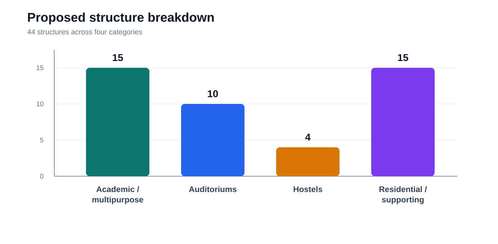
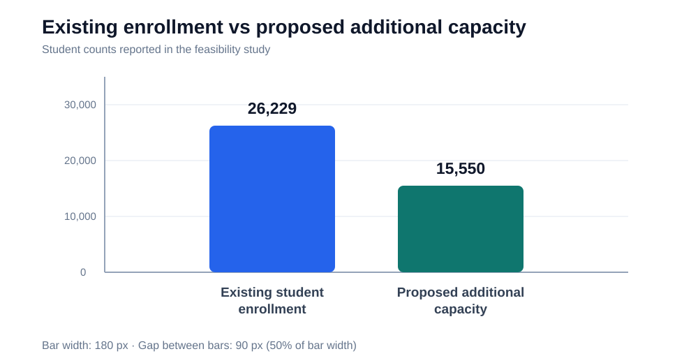
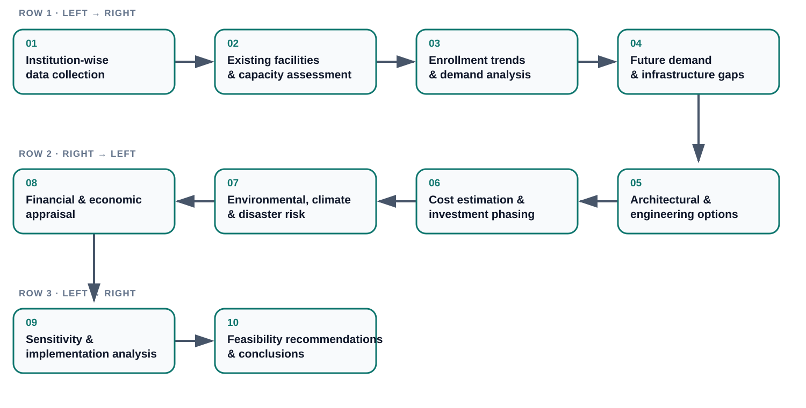

# Feasibility Study for Infrastructure Development of Selected Military and Cantonment Educational Institutions

  
  
  
  

| | |
| --- | --- |
| **Author** | Md. Takbir Hossain, Project Engineer |
| **Organisation** | Atlas Engineering Solution (AES) |
| **Client** | Secondary and Higher Education Division, Ministry of Education, Government of Bangladesh |
| **Implementing agency** | Education Engineering Department (EED) |
| **Report date** | September 2026 |
| **Document status** | Public summary v1.0, last updated 3 November 2026 |

**Summary.** This repository is a public overview of a completed feasibility study for the infrastructure development of 13 military and cantonment educational institutions across 11 districts of Bangladesh. The study assessed existing facilities, projected future student demand, and proposed need-based, climate-resilient and inclusive development covering 44 structures and an estimated capital investment of approximately Tk. 950 crore.

## At a glance

| Project dimension | Summary |
| --- | --- |
| Education coverage | 13 military and cantonment educational institutions |
| Geographic spread | 11 districts, 5 divisions |
| Infrastructure proposal | 44 proposed structures |
| Existing enrollment | 26,229 students |
| Proposed additional capacity | 19,578 students |
| Additional built-up area | 160,112 m² |
| Additional hostel capacity | 750 beds |
| Estimated capital investment | Approximately Tk. 950 crore |
| Implementation period (as stated in the report) | September 2026 – August 2029 |

> **Access to the full report.** The complete report and supporting material are not published here. Requests for access (subject to client approval and, where required, a non-disclosure agreement) can be made through the [author's GitHub profile](https://github.com/takbir-h-rudro).

## Contents

- [What this repository is and is not](#scope-of-repository)
- [Overview](#overview)
- [Geographic coverage and map](#geographic-coverage)
- [Key statistics and charts](#key-statistics)
- [Scope and methodology](#scope-and-methodology)
- [Codes and standards](#codes-standards)
- [Deliverables](#deliverables)
- [Acknowledgement](#acknowledgement)
- [Data notes, citation and version](#data-notes)

## What this repository is and is not

| This repository **is** | This repository **is not** |
| --- | --- |
| A public summary of the project's scope, approach and headline figures | The feasibility study report |
| A location map, institution list and school photographs | A source of survey data, drawings or design documents |
| Summary charts and the data behind them | A source of cost estimates, quantities or economic models |
| A reference point for citing the project | A basis for design, procurement or investment decisions |

The full report, architectural and engineering drawings, detailed cost estimates, economic analysis, digital survey data and technical appendices are held by the author and the client. They are available on request, at the client's discretion, and may be subject to a non-disclosure agreement. Figures here are rounded for public presentation (investment to the nearest Tk. 50 crore; coordinates to two decimal places).

## Overview

Military and cantonment schools in Bangladesh provide structured, quality education to both military and civilian communities. Rising enrollment, limited classroom capacity, inadequate laboratory and ICT facilities, insufficient accommodation and ageing buildings have created a need for systematic infrastructure development.

The study evaluates these needs across 13 institutions and sets out an integrated framework based on institutional requirements, projected student demand, existing physical conditions and long-term sustainability. Its objectives were to:

- Assess infrastructure deficiencies at each institution.
- Evaluate present and future student demand and capacity requirements.
- Formulate need-based proposals for academic buildings, laboratories, libraries, hostels, residential facilities and supporting infrastructure.
- Improve water supply, sanitation, electricity and ICT facilities.
- Incorporate climate resilience, environmental sustainability, disaster risk reduction and inclusive access.
- Evaluate technical, economic, institutional and implementation feasibility.

The result is a consolidated planning framework that supports informed investment decisions and aims to expand educational capacity, improve learning environments and strengthen the long-term sustainability of the institutions' infrastructure.

## Geographic coverage and map

The 13 institutions are distributed across **11 districts and 5 divisions**. Khulna and Dhaka each account for two institutions; every other district accounts for one.

  <a href="assets/Bangladesh_13_Schools_Map.svg">View the full-size SVG map</a>

**Data:** [`schools.csv`](assets/schools.csv) holds the 13 records (district, approximate latitude/longitude, institution name, photo number).

**Notes:**
- Coordinates are approximate and rounded to two decimal places (about 1 km) for public release; they are not surveyed measurements.
- The map shows the schools as independent locations; no route or connection between them is implied.
- Two inset panels give enlarged context for the closely spaced Khulna and Savar pairs.

### Institutions

| No. | Educational institution | District | Upazila / Thana | Photo |
| --: | --- | --- | --- | --- |
| 01 | Sena Public School & College, Kalukhali | Rajbari | Kalukhali | [01.jpg](assets/school-photos/01.jpg) |
| 02 | Military Collegiate School, Faridpur | Faridpur | Faridpur Sadar | [02.jpg](assets/school-photos/02.jpg) |
| 03 | Cantonment Public School & College, Jahanabad | Khulna | Phultala | [03.jpg](assets/school-photos/03.jpg) |
| 04 | Military Collegiate School, Khulna | Khulna | Phultala | [04.jpg](assets/school-photos/04.jpg) |
| 05 | Cantonment Public School & College, Saidpur | Nilphamari | Saidpur | [05.jpg](assets/school-photos/05.jpg) |
| 06 | Padma Cantonment Public School & College, Jajira | Shariatpur | Jajira | [06.jpg](assets/school-photos/06.jpg) |
| 07 | Jessore English School & College | Jashore | Jashore Sadar | [07.jpg](assets/school-photos/07.jpg) |
| 08 | Barishal Cantonment Public School & College | Barishal | Bakerganj | [08.jpg](assets/school-photos/08.jpg) |
| 09 | Cantonment Public School & College, Kholahati | Dinajpur | Parbatipur | [09.jpg](assets/school-photos/09.jpg) |
| 10 | Cantonment Public School & College, Lalmonirhat | Lalmonirhat | Lalmonirhat Sadar | [10.jpg](assets/school-photos/10.jpg) |
| 11 | Ramu Cantonment English School & College | Cox's Bazar | Ramu | [11.jpg](assets/school-photos/11.jpg) |
| 12 | Sena Public School & College, Savar | Dhaka | Savar | [12.jpg](assets/school-photos/12.jpg) |
| 13 | Savar Cantonment Morning Glory School & College | Dhaka | Savar | [13.jpg](assets/school-photos/13.jpg) |

## Key statistics and charts

| Parameter | Reported value |
| --- | ---: |
| Number of institutions | **13** |
| Existing student enrollment | **26,229** |
| Additional student capacity proposed | **19,578** |
| Proposed additional built-up area | **160,112 m²** |
| Total proposed structures | **44** |
| Proposed additional hostel capacity | **750 beds** |
| Estimated capital investment | **Approximately Tk. 950 crore** |

### Proposed structure breakdown

### Projected student numbers

The chart compares the 2026 base condition with projected demand in 2031 and 2036 under the without-project and with-project scenarios. Data: [`future-projected-students.csv`](assets/future-projected-students.csv).

Proposed additional capacity is a planning parameter, not a forecast of actual enrollment. Investment is rounded for this public overview.

## Scope and methodology

The study covers the following components:

<strong>Basic information and institutional assessment</strong>

- Institutional profiles and existing facilities.
- Geographic distribution and institutional characteristics.
- Existing infrastructure conditions and development requirements.

<strong>Market and demand analysis</strong>

- Historical enrollment trends, admission demand and growth.
- Capacity-constrained demand projections.
- Classroom requirements and future capacity assessment.

<strong>Technical and engineering assessment</strong>

- Existing infrastructure assessment.
- Architectural planning and proposed development layouts.
- Structural and engineering considerations, utilities and supporting facilities.
- Construction requirements and preliminary cost estimation.

<strong>Environmental sustainability and climate resilience</strong>

- Environmental impact considerations and management measures.
- Climate vulnerability, resilience and disaster risk assessment.

<strong>Financial and economic analysis</strong>

- Capital investment and implementation-period phasing.
- Operation and maintenance costs.
- Economic benefits and appraisal indicators.

<strong>Human resources, institutional and legal assessment</strong>

- Human resource requirements and management capacity.
- Institutional responsibilities and applicable regulatory requirements.

<strong>Risk, sensitivity and alternatives</strong>

- Implementation risks and sensitivity assessment.
- Evaluation of alternative development proposals and recommendations.

The study follows an integrated framework combining institutional data collection, demand forecasting, engineering assessment, infrastructure planning, cost estimation and economic evaluation.

## Codes, standards and guidelines

- Bangladesh National Building Code (**BNBC 2020**)
- Public Works Department (**PWD**) Schedule of Rates, June 2022 (Revised)
- Environmental Conservation Rules (**ECR 2023**)

## Deliverables

The completed study comprises the items below. **None of them is included in this repository**; see [what this repository is and is not](#scope-of-repository).

| Deliverable | Available here? |
| --- | :---: |
| Consolidated feasibility study report | On request |
| Institution-wise infrastructure assessments | On request |
| Student demand projection and capacity analysis | Summary chart only |
| Architectural planning and proposed development drawings | On request |
| Detailed infrastructure cost estimates | On request |
| Economic analysis and appraisal documentation | On request |
| Environmental sustainability and disaster risk assessment | On request |
| Sensitivity analysis | On request |
| Digital survey and supporting survey data | On request |
| Technical appendices, recommendations and implementation considerations | On request |

"On request" is at the client's discretion and may require a non-disclosure agreement.

## Acknowledgement

- **Commissioning division:** Secondary and Higher Education Division, Ministry of Education, Government of Bangladesh.
- **Implementing agency:** Education Engineering Department (EED).
- **Consulting organisation:** Atlas Engineering Solution (AES).

## Data notes, citation and version

- Project details are summarised from the September 2026 feasibility study report. Figures are rounded for public presentation.
- Map data: [Natural Earth](https://www.naturalearthdata.com/) (public domain) and [geoBoundaries Bangladesh ADM1–ADM2](https://www.geoboundaries.org/countryDownloads.html) (CC BY 4.0).
- To cite this summary, use the "Cite this repository" button on GitHub (see [`CITATION.cff`](CITATION.cff)).
- **Version:** public summary v1.0, last updated 3 November 2026.

*This repository is a documentation summary of the completed feasibility study. All technical findings, estimates and recommendations should be read with reference to the consolidated report and its annexes.*
